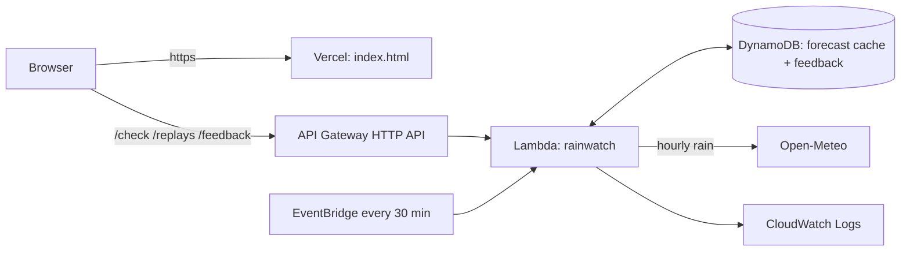

# Jowar: rain + tide commute check

Built for **Environmental Hacks** (Bharat Builds Tour, WeMakeDevs x AWS), track **Heat and Water** (monsoon waterlogging).
First commit: `[FILL IN: date and time of your first commit]`.

**Live URL:** `[FILL IN: your Vercel URL]`
**Demo video:** `[FILL IN: your YouTube link]`

## The problem
In Kolkata the same rain is worse when it lands on a high tide. The drains empty into the Hooghly, and the mayor said during Cyclone Dana (25 Oct 2024) that high tide and continuing rain could slow drainage. Commuters get stuck on main roads such as Behala, Hazra, Bhawanipur, VIP Road and New Town, and they have no way to see rain and tide together before choosing when to leave.

## Who it is for
People who travel through the same flood-prone main-road areas every week and can choose when to leave. The builder commutes through New Town and the Kaikhali / Haldiram bridge area.

## What it does
Pick one of 8 areas, a day and an hour. You get **Lower risk / Caution / High risk**, the reasons (rain total, high tide nearby), a suggested better time, and a 24-hour strip showing risk for every departure hour with the high tides marked. After a trip you can tap "Did this area flood?", which builds a local record over time.

The page header shows the sky for the hour you chose: rain clouds and falling rain when the 4-hour rain total is 1 mm or more (more rain at 5 mm and 15 mm, the same steps the risk score uses), blue sky with a sun on a dry daytime hour, and a moon on a dry night hour.

A **Replay** tab re-runs real past floods (Cyclone Dana 2024, the record rain of 23 Sep 2025) so the tool can be judged on days when it was not dry.

## Why not a weather app, the news or a phone call?
Jowar does one narrow job. For one area and one departure hour it adds up the rain around that hour, checks whether a Garden Reach high tide falls near it, and suggests a better hour.

- **Weather apps and rain maps (for example Windy)** show how much rain is coming for a place. Jowar adds the high tide and gives one answer for each area and hour.
- **IMD alerts** give a colour warning for a whole district. Jowar answers for a named area and an hour.
- **News and TV** report flooding once it has started. Jowar looks at the hours ahead.
- **Calling someone local** tells you what one road looks like now. Jowar covers 8 areas for the next 3 days without anyone on the road. On a risky day, do both.

**What Jowar does not do.** It uses the same kind of free forecast data as weather apps, so it is not better at predicting rain, and it missed the 23 September 2025 burst. It is a planning aid. Confirm with local news or someone on the road.

**Prior work.** KMC put display boards showing rainfall and tides at 7 junctions in 2017, and it runs a flood early warning system with automatic rain gauges for city staff. I could not verify whether either is open to the public today. I did not find a public commuter tool that shows rain and tide together by area and hour. That is not proof that none exists.

## How it works


| AWS service | Job it does here |
|---|---|
| Lambda | Fetches rain, scores risk, serves the API, stores feedback |
| API Gateway (HTTP API) | Public API with throttling |
| EventBridge | Refreshes the forecast cache every 30 minutes |
| DynamoDB | Forecast cache (so the weather service is not hit per user) and feedback |
| Vercel (not AWS) | Serves the static web page over https. Everything else runs on AWS. |
| CloudWatch | Logs and the evidence of requests |

**Risk rule (placeholder thresholds, see `scoring.py`):** rain in a 4-hour window around departure gives 0 to 3 points (5, 15, 30 mm). A high tide near the window adds 1 point when it is raining. 3 or more points is High risk, 2 is Caution. Reported flood history for an area is shown but adds no points. This is a rules-based risk window, not AI and not a flood prediction.

## Data and credits
- Rain: [Open-Meteo](https://open-meteo.com/) forecast and archive APIs (CC BY 4.0, non-commercial free tier). Modelled data, not gauge readings.
- Tide: high-tide times for Calcutta (Garden Reach) typed from [tide-forecast.com](https://www.tide-forecast.com/locations/Calcutta-Garden-Reach-India/tides/latest) on 11 Oct 2026. A prediction site, not official. `[CHECK their terms before keeping tides.json public]`
- Flood history per area: PTI report on Cyclone Dana (25 Oct 2024) via The Week, PTI via Deccan Herald (24 Sep 2025), and the builder's own observation. Each source is listed in `corridors.json`.

## Honest limits
- **The model understates heavy bursts.** For Cyclone Dana the model shows about 40 mm for the 24 hours to 11:30 am, while the Alipore Met office recorded over 100 mm. The replay is therefore a sanity check, not proof of accuracy.
- **23 Sep 2025:** the model shows under 1 mm in each hour from 3 to 6 am, where IMD reported a 98 mm hour. The tool says Lower risk there. The replay data was requested for 22.57, 88.36, which Open-Meteo snapped to a grid point at 22.601, 88.318 in north Kolkata. Live checks use each area's own coordinates from `corridors.json`, which are approximate.
- No tide table is loaded for the replay dates, so tide is not counted there. The page says so.
- Thresholds are guesses and are not validated against IMD or KMC guidance.
- Garden Reach tide timing differs along the river. Rain varies little across one city in this model, so areas differ mostly by their history note.
- `[FILL IN after step 6 of the guide: what happened when 3 people tried it]`

## Privacy
No names, phone numbers, IP addresses or locations are stored. Feedback stores only: area, departure hour, the level shown, and yes or no.

## Run the tests (no AWS, no network)
```
python test_handler.py
node test_ui.js
```
`test_handler.py` tests the API and scoring with a fake database and forecast. `test_ui.js` (needs Node.js) runs the page's own script against a fake page and fake API, covering the live check, the replay tab and the feedback button.

## Legal
See `privacy.html` and `terms.html`. Both are linked from the page footer. They are plain-language statements for a student project.

## Deploy
See `DEPLOY.md`.
